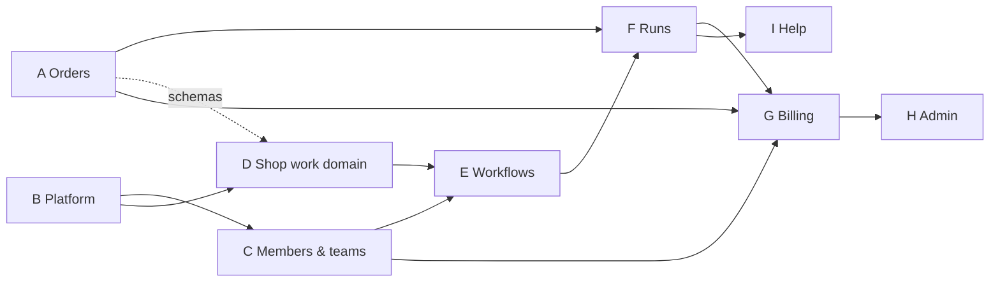

# Legacy port: research

Status: research, 2026-10-17. **Settled**: all 20 questions in §6 decided as recommended, in review on 2026-10-17. No code has changed. Q16 and Q17 done the same day: the glossary is fixed, `docs/orders-slice-research.md` is settled. Plans: `docs/orders-slice-plan.md` (slice A, `main`, done and on staging 2026-10-17) and `docs/domain-port-plan.md` (slices B and D, done and merged 2026-10-17 as cb9be09). Later on 2026-10-17: slices B and D implemented on `wt-01` (`src/domain/platform.ts`, `orders.ts`, `shop-work.ts`; §3 marks them). **Amended 2026-10-17** (§0.1): the actor owns its shop (D1, Admin API, Workflow), every browser write is a procedure, one socket per tab. The architecture correction is **done** 2026-10-17 (`docs/actor-ownership-research.md`, `docs/actor-ownership-plan.md`, `docs/actor-workflow-wiring-research.md`; staging verified at 1316962). Slice C is **done** 2026-10-18 (staging verified at 5107eb3); E (workflows) is next.

**The question.** `refs/baton-legacy` is a working app: about 46k lines of source, 34k of tests, one Worker on wrangler. This repo is its replacement on Alchemy, two Workers and an actor, with Better Auth, embedded Shopify auth, token refresh, the actor socket, seeds, fixtures and the test layers already in place, and every per-shop table declared but unread. The question is how the remaining ~90% of legacy gets here: in what pieces, in what order, by what rules, and what is left behind.

**How to read it.** §0 is the decisions. §1 is where we stand. §2 maps legacy's architecture onto this one. §3 cuts legacy into slices and sizes them. §4 proposes an order and a working rhythm. §5 is what is not ported. §6 is the questions as asked, each with the recommendation that was accepted.

Legacy paths are relative to `refs/baton-legacy/`.

## 0. Decisions

| Q   | Decision                                                                                                                        |
| --- | ------------------------------------------------------------------------------------------------------------------------------- |
| Q1  | A research-plus-plan pair per slice; this doc is the index and its §3 table carries status.                                     |
| Q2  | Orders (A) on `main` and Platform then Shop work (B, D) in `wt-01`, in parallel.                                                |
| Q3  | Domain in `src/domain/` as four context files, no barrel; `src/contract/` imports from it.                                      |
| Q4  | JSDoc tables and their pinned tests port; the spec parser and custom linter do not. Import direction via oxlint.                |
| Q5  | Each callable sorts into server function (first-render read), procedure (live read, browser write) or stub method (Backend).    |
| Q6  | Reconcile stays inside the actor's order-write transaction.                                                                     |
| Q7  | Billing keeps legacy's App Pricing and Partner API design; deferred until runs (F) work.                                        |
| Q8  | Webhooks enter on the Website and forward to the Backend; cron is declared on the Backend. No public Backend route.             |
| Q9  | D1 read replicas and bookmarks are dropped.                                                                                     |
| Q10 | Admin console ports the shops list and shop detail only.                                                                        |
| Q11 | Screen parts port on demand; the kit page arrives with Workflows (E).                                                           |
| Q12 | Domain and repository tests go to unit (repositories over an in-process SQLite layer, after a spike); actor behaviour to integ. |
| Q13 | A and B/D run in parallel worktrees; B/D merge first.                                                                           |
| Q14 | Member routes keep `$key` with legacy's structure under it.                                                                     |
| Q15 | `/app/orders/from-shopify` lands in A.8.                                                                                        |
| Q16 | Glossary's layout table is fixed now; the domain-nouns section comes with B.                                                    |
| Q17 | The orders research gets a rename-and-decide pass, then a plan. No re-research.                                                 |
| Q18 | Production is designed after Billing (G).                                                                                       |
| Q19 | Keep `read_products` and the JSON columns; no product sync.                                                                     |
| Q20 | Logging and SQL rules join `AGENTS.md` with slice A.                                                                            |

### 0.1 Amendment: the actor owns its shop (review, 2026-10-17)

Found while researching slice C (`docs/members-teams-research.md`, parked). Legacy's `ShopAgent` is the owner of its shop: it holds `env.D1` in its own runtime (`makeRunEffect` in `ShopAgent.ts`), reads the shop's teams live, deletes teams, refreshes the offline token, calls the Admin API (`agent/Orders.ts`), and starts and tracks `OrdersSyncWorkflow` (`runWorkflow`). One socket per tab is held by the `/app` and `/shop/$shop` layouts (`ShopAgentSocketProvider`). This repo diverged on each point without a question asking it. Decided:

| #   | Decision                                                                                                                                                                                                                                                                                                                       | Supersedes                                                                                                                     |
| --- | ------------------------------------------------------------------------------------------------------------------------------------------------------------------------------------------------------------------------------------------------------------------------------------------------------------------------------ | ------------------------------------------------------------------------------------------------------------------------------ |
| A1  | The actor owns its shop as legacy's object does: it gets the `AuthDb` binding (read and write), calls the Admin API, refreshes the offline token, and creates and tracks the orders sync Workflow. The Backend is the front door: the socket gate, HMAC-checked webhooks forwarded to the actor, cron, and first-render reads. | §1.3 "Admin API calls run in the Backend, never in the actor"; `docs/orders-slice-research.md` Q1 and Q4.                      |
| A2  | A read a page needs on first render is a server function (SSR, and the socket query is seeded from it). Every browser write and every live read is a role-prefixed procedure on the socket. A server function writes only when the actor genuinely cannot do the work.                                                         | Q5 (restated and tightened; the orders screen's sync buttons become procedures).                                               |
| A3  | One socket per tab, held by the `/app` layout (merchant) and the member shop layout, kept open across navigation; pages seed and read their queries and never own the socket.                                                                                                                                                  | The per-page socket the orders screen and the member shop page have today (the client is released when no page reads an atom). |

**Refined 2026-10-17** (`docs/actor-ownership-research.md`, settled): under A1 the actor makes the one-order Admin calls and creates the Workflow instance, while the bulk Admin calls stay in the Workflow, as legacy's `OrdersSyncWorkflow` made them itself; the Workflow's callbacks into the actor stay stub methods.

Slices B and D are unaffected (pure). Slice A's ownership is reworked by an **architecture correction** with its own research and plan, before C resumes; C's research keeps its settled answers and is revised for A2 and A3.

### 0.2 Amendment: naming by role (review, 2026-10-18)

Found while researching slice E (`docs/workflows-research.md` Q2). The actor's per-area modules kept legacy's `…Agent` names (`OrdersAgent`, `MembersAgent`), which came from the Cloudflare Agents SDK and read here as further objects. Decided: one actor, one module per **area** of shop work (orders, membership, workflows, runs), named by role. Storage is `<Area>Repository` (one store's SQL, nothing else); the area's **application service** (its use cases: rules across stores, the repository call, closes, reconcile, notify, the answer) takes the area's bare name (`makeOrders`, `makeMembership`, `makeWorkflows`, `makeRuns`). `Members` becomes `MembershipRepository`, `ShopSessions` `ShopSessionRepository`, `OrdersBulkRepository` `OrdersBulkOperation` (it stores nothing). "Workflow" alone is the product's; Cloudflare's is the orders sync Workflow. Lands as E's first step. Supersedes the `…Agent` names in §3's rows and slice C's Q19 (`makeMembersAgent`). The same review adds `src/domain/workflow-layout.ts` (legacy's `WorkflowLayout`) beside Q3's four context files, inside shop work.

---

## 1. Where we stand

### 1.1 What is ported

| Area                                                                   | Here                                                                                       | Status                                                                                                                                            |
| ---------------------------------------------------------------------- | ------------------------------------------------------------------------------------------ | ------------------------------------------------------------------------------------------------------------------------------------------------- |
| Shopify embedded auth: session token, token exchange, bounce, CSP      | `src/backend/shopify.ts`, `src/web/server/shopify*.ts`, `src/web/routes/app.tsx`, `auth.*` | Done. App Home renders a placeholder.                                                                                                             |
| Offline token refresh, lease, race recovery, `ShopifyAdmin`            | `src/backend/shopify.ts`, `shop-sessions.ts`, `shopify-admin.ts`                           | Done. Only `PingAdmin` calls it.                                                                                                                  |
| Member and admin sign-in (Better Auth magic link, invite-only, revoke) | `src/backend/auth.ts`, `api.ts`, `src/web/routes/sign-in.tsx`                              | Done.                                                                                                                                             |
| Per-shop actor: gate, roles, sockets, notices, displacement, expiry    | `src/backend/shop-actor.ts`, `actor-socket.ts`, `shop-access.ts`, `src/web/client/*`       | Done. Procedures are a demo counter.                                                                                                              |
| D1 `ShopSession`, `Member`, `Team`, `TeamMember`                       | `migrations/0001_init.sql`, `src/backend/members.ts`, `shop-sessions.ts`, `d1-tables.ts`   | Done: sessions; members and teams read (loaders, gate) and written (the actor's `Merchant…` procedures); `D1_TABLES`; session cap and auth sweep. |
| Actor tables `ShopOrder` … `RunTask` (all eight)                       | `shop-actor.ts` `0001_init`                                                                | Schema only. Fixture writes them; nothing reads them.                                                                                             |
| Seed per environment, dev and e2e fixtures                             | `seed/`, `fixture.ts`, `src/backend/fixture.ts`, `DevRpcs`                                 | Done. The dev fixture is legacy's showcase shop.                                                                                                  |
| Stages, staging deploy, stage config, cloud reset                      | `alchemy.run.ts`, `src/backend/stack.ts`, `stacks/`, `scripts/`                            | Done.                                                                                                                                             |
| Test layers: unit, browser, integ (test Backend, stage per file), e2e  | `test/`                                                                                    | Done (`docs/testing-plan.md`).                                                                                                                    |
| Shopify app config and webhook subscriptions                           | `shopify.app*.toml`, `extensions/baton-order-link`                                         | Declared. No `/webhooks/*` route; staging gets 404s today.                                                                                        |

### 1.2 What is not

Everything the merchant and the members actually use: orders, workflows, runs and tasks, teams and members management, billing, the admin console, help. In lines, that is the bulk of legacy:

| Legacy area                                                         | Lines (approx.)                                                          |
| ------------------------------------------------------------------- | ------------------------------------------------------------------------ |
| Domain contexts, `src/lib/domain/`                                  | 5,800 (`ShopWork.ts` 4,253; `Platform` 581; `Orders` 489; `Billing` 477) |
| Actor services, `src/lib/agent/` + `ShopAgent.ts`                   | 4,800                                                                    |
| Repositories (orders, runs, workflows, D1)                          | 6,500                                                                    |
| Shopify integration (`Shopify.ts`, Partner, Events, bulk, Workflow) | 3,200; about a third already ported                                      |
| Merchant routes `app.*`                                             | 7,000                                                                    |
| Member routes `shop.*`                                              | 1,650                                                                    |
| Admin, auth, public, help routes                                    | 2,500                                                                    |
| Components (screen parts 1,700; help 2,600; app 1,200)              | 5,500                                                                    |
| Tests                                                               | 34,000 (about 1,100 cases)                                               |
| Scripts                                                             | 14,200                                                                   |

### 1.3 Decisions already made that bind the port

These are settled in earlier research and are not reopened here:

- **Two transports, no more** (`docs/actor-channel-split-research.md`). The Backend calls schemaless methods on the actor's stub; the browser calls Effect RPC procedures over the socket; the Website calls the Backend's schemaless methods from server functions. Legacy's `@callable()` surface and `ShopAgentClient` do not come across as they are; each legacy callable becomes a procedure (browser-facing) or a stub method (Backend-facing).
- **The Website has no Effect runtime.** Loaders and server functions are plain TypeScript that decode with Schema and call the binding. Legacy's `requestContext.runEffect` and its server-function middlewares (`ShopifyServerFnMiddleware`, `MemberServerFnMiddleware`, `AdminServerFnMiddleware`) are replaced by the Backend's gate and `authenticateAdmin`.
- **One dev door, `DevRpcs`** (`docs/testing-research.md` Q15, Q18). Legacy's `api.dev.seed.ts`, test worker and the fake layers inside production code do not come across. e2e runs on the real store; fakes live in the test Backend.
- **Schema changes edit `0001_init` in place** and land by reset (`vp run db:reset`, `vp run cloud:reset`). No second migration file until production exists.
- **The actor owns its shop** (§0.1 A1 and its refinement): it reads and writes its shop's `AuthDb` rows through the Backend's own `ShopSessions`, makes the one-order Admin API calls through the Backend's `ShopifyAdmin` (refreshing the offline token when a call needs it), and creates the orders sync Workflow's instances. The bulk Admin calls stay in the Workflow, which calls the actor back. The Backend is the front door: the socket gate, HMAC-checked webhooks forwarded to the actor after the installed-shop check, cron, and first-render reads.
- **Polaris web components from the CDN, layout only in screen parts** (`AGENTS.md`). Legacy already follows this; its parts port.
- **No "demo" framing.** The sandbox code is reference patterns; legacy is the product.

---

## 2. Architecture map

How each legacy mechanism lands here. "Same" means the code ports with renames only.

| Legacy                                                                      | Here                                                                                                                  | Change                                                                                                                                                                                                                                                                                                          |
| --------------------------------------------------------------------------- | --------------------------------------------------------------------------------------------------------------------- | --------------------------------------------------------------------------------------------------------------------------------------------------------------------------------------------------------------------------------------------------------------------------------------------------------------- |
| `wrangler.jsonc` with `env.staging` / `env.production`                      | `alchemy.run.ts` + `src/backend/stack.ts` + `stage.ts`                                                                | Done. Production joins when designed.                                                                                                                                                                                                                                                                           |
| One Worker: Start SSR, `routeAgentRequest`, webhooks, cron                  | Website (Start, public) + Backend (Effect, private) + `ShopActor`                                                     | Routes split by who holds the secret: webhooks and cron land on the Website and forward to the Backend, or live on the Backend if it gains a public route (Q8).                                                                                                                                                 |
| `ShopAgent extends Agent` (agents SDK): `@callable`, `publish`, `onConnect` | `ShopActor` on Alchemy's `DurableObject`, Effect RPC socket, `Notice` frames, schemaless stub methods                 | Each callable is re-homed (§3). `publish` is `notify`; the sites table on `ShopAgent.publish` is the spec for which writes notify.                                                                                                                                                                              |
| `ShopAgentClient` typed facade                                              | `ShopActors` (`src/backend/shop-actors.ts`)                                                                           | Same role, schemaless.                                                                                                                                                                                                                                                                                          |
| `useLiveQuery` + React Query, invalidation over the socket                  | `ShopActorClient.query` atoms with reactivity keys, `seedShop` from the loader                                        | Same model; the glossary's "Query atom", "Reactivity key", "Seed (atom)".                                                                                                                                                                                                                                       |
| `ShopAgentSocketHost`, `ShopAgentContext`, `SocketBanner`                   | `src/web/client/actor-connection.ts`, `shop-actor-client.ts`; `ShopSocket` and `SocketBanner` (`src/web/components/`) | Done: one socket per tab, held by the `/app` and member shop layouts; pages seed and read. Legacy's keepalive and watchdog are not ported: Effect's RPC client pings and reconnects, and Alchemy's `RpcWebSocket` answers at the edge.                                                                          |
| `OrdersSyncWorkflow extends AgentWorkflow`                                  | `Cloudflare.Workflow` in the Backend, steps as `Cloudflare.Workflows.task`                                            | Alchemy's Workflow class (`refs/alchemy/website/src/content/docs/cloudflare/compute/workflows.mdx`). The actor creates instances, over the Backend's binding, and records `SyncState`; the Workflow makes the bulk calls and calls the actor back (`onOrdersStream`, `onOrdersSyncEmpty`, `onOrdersSyncError`). |
| Cron `17 4 * * *` → `revalidateStalePlans`                                  | `Cloudflare.Workers.cron` on the Backend (`refs/alchemy/.../messaging/cron.mdx`)                                      | Same job, billing slice.                                                                                                                                                                                                                                                                                        |
| D1 Sessions API, bookmarks into SSR dehydrate                               | `AuthDb` with read replication off                                                                                    | Dropped (Q9).                                                                                                                                                                                                                                                                                                   |
| `KV` for demo magic links                                                   | `MagicLinkDelivery` inline on dev                                                                                     | Gone.                                                                                                                                                                                                                                                                                                           |
| `EMAIL`, `LOGIN_LIMITER`                                                    | `AuthEmail`, `SignInLimit`                                                                                            | Done.                                                                                                                                                                                                                                                                                                           |
| `ADMIN_EMAILS` bootstrap, `/admin` console                                  | Admin seeded per environment; `admin.*` routes                                                                        | Console pages to port (Q10).                                                                                                                                                                                                                                                                                    |
| `SHOPIFY_PARTNER_API_TOKEN`, org/app ids, app handle                        | Stage config record + Alchemy bindings                                                                                | Billing slice.                                                                                                                                                                                                                                                                                                  |
| `src/lib/Domain.ts` barrel + `domain/{ShopWork,Orders,Billing,Platform}.ts` | `src/domain/` (Q3)                                                                                                    | Pure Schema; ports nearly verbatim.                                                                                                                                                                                                                                                                             |
| `Repository.ts` (D1), `*Repository.ts` (actor SQLite) over `SqlClient`      | `src/backend/members.ts`, `shop-sessions.ts` (D1); actor repositories inside `src/backend/shop-actor/…`               | Same `SqlClient` style; `transaction()` already has the `MixedScheduler` fix.                                                                                                                                                                                                                                   |
| `scripts/spec.ts`, `rules-lint.ts`, vocabulary audit                        | none                                                                                                                  | Q4.                                                                                                                                                                                                                                                                                                             |
| `scripts/dev.ts`, worktrees, dev stores                                     | `scripts/dev.ts`, `worktree.ts`, `stores.ts`                                                                          | Done, Alchemy-shaped.                                                                                                                                                                                                                                                                                           |
| `@cloudflare/vitest-plugin` integration project in workerd                  | unit (Effect layers), integ (deployed test Backend), browser, e2e                                                     | No workerd-in-Vitest. Repository tests need a home (Q12).                                                                                                                                                                                                                                                       |

---

## 3. The slices

Legacy cuts along its bounded contexts (`src/lib/Domain.ts` map): platform (dialect), orders (supporting), billing (generic), shop work (core). The port follows the same seams, outside-in: what Shopify gives us (orders), then what the shop sets up (members, teams, workflows), then the work itself (runs, tasks, reconcile), then what it costs (billing), then the operator and public surfaces.

| #   | Slice                          | Legacy source                                                                                                                                                                                                | Delivers here                                                                                                                                                                                                                                                                                                                                                                   | Approx. lines | Depends on          |
| --- | ------------------------------ | ------------------------------------------------------------------------------------------------------------------------------------------------------------------------------------------------------------ | ------------------------------------------------------------------------------------------------------------------------------------------------------------------------------------------------------------------------------------------------------------------------------------------------------------------------------------------------------------------------------- | ------------- | ------------------- |
| A   | **Orders**                     | `domain/Orders.ts`, `OrderRepository.ts` (sync subset), `OrdersBulkRepository.ts`, `OrdersSyncWorkflow.ts`, `ShopAgentOrdersStream.ts`, `agent/Orders.ts`, `routes/webhooks.*`, a thin orders index          | **Done** 2026-10-17 on `main` (`docs/orders-slice-plan.md`; staging verified 2026-10-17: sync, uninstall and reinstall, after the `storage.sync()` fix b2eed62); ownership reworked by the actor ownership correction, 2026-10-17 (`docs/actor-ownership-plan.md`, staging verified)                                                                                            | 4,000         | —                   |
| B   | **Platform dialect**           | `domain/Platform.ts`                                                                                                                                                                                         | **Done** 2026-10-17 on `wt-01` (`docs/domain-port-plan.md`). `src/domain/platform.ts`: ids, `ShopLimits`, roles, `InvalidatedMessage` → `Notice` keys                                                                                                                                                                                                                           | 600           | —                   |
| C   | **Members and teams**          | `Repository.ts` (D1 part), `teams.ts`, `MemberAccess.ts`, `routes/app.members.*`, `app.teams.*`, `shop.index`, member invite in `login.tsx`                                                                  | **Done** 2026-10-18 on `main` (`docs/members-teams-research.md`, `docs/members-teams-plan.md`; staging verified 2026-10-18 at 5107eb3): Members and Teams screens, every write a `Merchant…` procedure the actor runs over `Members`, the 50-member and 50-team ceilings, the actor closing affected members' sockets, `s-app-nav`, the session cap and auth sweep, Your stores | 3,500         | B                   |
| D   | **Shop work domain**           | `domain/ShopWork.ts` and its tests                                                                                                                                                                           | **Done** 2026-10-17 on `wt-01` (`docs/domain-port-plan.md`; matrix row tests wait for F). `src/domain/shop-work.ts`: run, task, workflow schemas; `runActions`, `taskActions`, `reconcileItem` matrices; pure, fully unit-tested                                                                                                                                                | 4,300 + tests | B, A (schemas only) |
| E   | **Workflows**                  | `WorkflowRepository.ts`, `WorkflowLayout.ts`, `workflow*.ts`, components `WorkflowSteps/Switch/Tag`, `routes/app.workflows.*`                                                                                | Workflow list, detail, draft editor, Apply, Turn on; `Workflow` rows read and written                                                                                                                                                                                                                                                                                           | 4,500         | C, D                |
| F   | **Runs and reconcile**         | `RunRepository.ts`, `agent/ShopWork.ts`, `useMemberRunActions.ts`, components `RunSteps/RunTextModals/MemberRun`, `routes/app.orders.$orderId.tsx`, full `app.orders.index.tsx`, `shop.$shop.workflows.*`    | Order page with runs per line item; member work list and item page; reconcile on every order write (the `afterWrite` seam from A)                                                                                                                                                                                                                                               | 9,500         | A, D, E             |
| G   | **Billing**                    | `domain/Billing.ts`, `SubscriptionPlan.ts`, `ShopifyPartner.ts`, `ShopifyAppEvents.ts`, `agent/Billing.ts`, `ManagePlanButton`, `QuotaBanners`, home meters in `app.index.tsx`, cron, plan gate in `app.tsx` | Plan gate, Partner API plan read with 24 h cache, usage-event outbox and flush, counted orders, home meters, lapsed page                                                                                                                                                                                                                                                        | 3,000         | A, C, F             |
| H   | **Admin console**              | `routes/admin.*`, `ShopAgentObjects.ts`                                                                                                                                                                      | Shops list, shop detail (session row, actor state, plan refresh, usage pending)                                                                                                                                                                                                                                                                                                 | 1,300         | A, G                |
| I   | **Public and help**            | `index.tsx`, `privacy.tsx`, `help.*`, `components/help/**`, `help*.ts`, `public/assets/help`                                                                                                                 | Landing, privacy, help hub and pages, screenshots                                                                                                                                                                                                                                                                                                                               | 3,500         | everything          |
| J   | **Screen kit** (cross-cutting) | `Screen.ts`, `components/screen/*` (44 parts), `dev.kit.tsx`                                                                                                                                                 | Parts ported on demand per slice (Q11)                                                                                                                                                                                                                                                                                                                                          | 2,500         | —                   |

Two things the slice table hides:

- **A, B and D are independent.** A is Backend and actor work with Shopify; B and D are pure modules with their own tests. They can run in parallel worktrees without touching the same files (Q13).
- **F is the product.** Everything before it is setup; everything after it is billing and polish. The earliest point at which a merchant can do real work is A + C + D + E + F, roughly 26k legacy lines. That is the milestone to aim at, and the reason to keep each earlier slice thin (orders index without runs columns, members without seat billing).

---

## 4. Proposed order and rhythm

### 4.1 Order

1. **A.1–A.5** (refresh is done; storage, ingress, `orders/*` webhooks, uninstall) on `main`. This is the researched path; it also stops staging's webhook 404s.
2. **B then D** in `wt-01`, in parallel with 1. Pure code and tests; ports nearly verbatim. D is the biggest single file in legacy and the one whose rules a merchant would notice if wrong, so it is worth porting while the surrounding system is still small.
3. **A.6–A.8** (bulk sync, one-order sync, sweep, thin orders screen).
4. **C** members and teams.
5. **E** workflows.
6. **F** runs and reconcile. First real milestone: a merchant sets up a workflow and a member does the work.
7. **G** billing, including the plan gate on `/app` and the cron. Needs plans created on the staging Shopify app first (`README.md` §Billing in legacy).
8. **H** admin, **I** help and public, in either order.

### 4.2 Rhythm per slice

The pattern that has worked here five times (channel split, stages, offline refresh, seed and fixture, testing):

1. **Research doc**, `docs/<slice>-research.md`: what legacy does, what carries over unchanged, what must change for Alchemy and Effect, risks, questions with recommendations. Legacy paths relative to `refs/baton-legacy/`.
2. **Decisions** in review; the doc's §1 becomes the decisions table.
3. **Spikes** where a decision rests on something unverified (orders has one: multi-checkout webhook delivery).
4. **Plan**, `docs/<slice>-plan.md`: rules for the implementer, outcome, names table, steps each ending green, verification, "Deviations and issues" log.
5. **Implement**; `vp check --fix`, `vp test`, `vp run test:e2e`; staging reset and push; embedded load verified.
6. **Prune**: the research and plan are deleted once the code carries the reasons in JSDoc (the `AGENTS.md` rule).

What the research must say for each slice, beyond legacy's behaviour:

- which legacy callables become **procedures** (`Member…`/`Merchant…`), which become **stub methods**, which become **server functions** (loader reads), and which disappear into the Backend;
- which **notices** each write sends (from legacy's `publish` sites table);
- which **`DevRpcs`** grow and how `AddToFixture` carries the slice's data;
- which legacy **tests** move to unit, which to integ, which to e2e (§6 Q12).

### 4.3 Porting rules

Rules that are not in `AGENTS.md` yet and should be, once the first slice that needs them lands:

- **Legacy is the spec, not the source.** Port behaviour and JSDoc rules; rewrite the shape to this repo's idioms (Effect 4 `Effect.fn`, `Match`, `Schema.TaggedError`, server functions). Pure domain code and SQL port verbatim; everything touching the agents SDK, `ManagedRuntime`, middlewares or `useLiveQuery` is rewritten.
- **Keep legacy's names** for domain words (run, task, workflow, team, member, counted order) and its screen names. The vocabulary tables port into the domain modules' JSDoc as they are.
- **Rules move with their symbols.** A JSDoc table (action matrix, sync table, triggers table, publish sites, data-model rules) moves to the symbol that carries it here, unchanged in content.
- **Logging** follows legacy's `AGENTS.md` form: one string message `<operation>: shop=<shop> key=<value>: <detail>`, structured fields in `Effect.annotateLogs`, shop in both.
- **SQL**: lowercase keywords, positional parameters, as legacy.

---

## 5. Not ported

Left behind on purpose, with the reason:

| Legacy                                                             | Why not                                                                                                                                                |
| ------------------------------------------------------------------ | ------------------------------------------------------------------------------------------------------------------------------------------------------ |
| `routeAgentRequest` gate, `x-partykit-namespace`, agents SDK       | Replaced by `ShopAccess` and the gate header.                                                                                                          |
| `requestContext.runEffect`, server-fn middlewares                  | The Website has no Effect runtime; the Backend is the boundary.                                                                                        |
| D1 Sessions API, bookmarks, `D1Primary`/`D1Bookmark`               | `AuthDb` has replication off; Better Auth owns the D1 client. Revisit if read latency shows (Q9).                                                      |
| `KV` demo magic links, `api.dev.seed.ts`, test worker              | `MagicLinkDelivery` inline and `DevRpcs` cover it.                                                                                                     |
| `authenticateFlowAction`                                           | Nothing calls it in legacy either.                                                                                                                     |
| `scripts/spec.ts`, `rules-lint.ts`, `vocab:audit`, `copy-audit`    | Q4.                                                                                                                                                    |
| `scripts/dev.ts` Herdr orchestration, `cost.ts`, TTS, icon scripts | This repo has its own `scripts/dev.ts`; the rest is tooling research, not product.                                                                     |
| `admin.shop-agent-objects`, `admin.orphan-shop-agent-objects`      | Need a Cloudflare API token in the Worker. Q10.                                                                                                        |
| Legacy `docs/` (32 files)                                          | Research is disposable by rule. Two are worth reading before their slice: `reconcile-spec-review-research.md` before F, `limits-research.md` before G. |
| `.env` `ADMIN_PASSWORD*`, `ADMIN_AUTH_SECRET`                      | Dead in legacy; the admin role is Better Auth's.                                                                                                       |

---

## 6. Questions

Each recommendation was accepted in review on 2026-10-17; §0 has the one-line form.

**Q1. One roadmap doc plus a research/plan pair per slice, or one master plan?**
Recommendation: the pair per slice, as the last five pieces of work did. This doc is the index: its §3 table gets a status column and is updated as slices close. A master plan for 30k lines would be stale by slice B.

**Q2. Order: Orders first (A) or domain first (D)?**
Recommendation: both, in parallel (§4.1). A on `main` because it is researched and fixes a live defect (staging webhooks). B then D in `wt-01` because they are pure, large, and conflict with nothing. If only one checkout is active, A first.

**Q3. Where does the domain live and does it keep legacy's four contexts?**
Recommendation: `src/domain/` as the glossary promised, four files `platform.ts`, `orders.ts`, `billing.ts`, `shop-work.ts`, no barrel. The map and import direction (shop work → orders → platform; billing → orders → platform) stay as JSDoc on each file's top symbol. `src/contract/` keeps only what crosses a boundary and imports from `src/domain/`; the fixture schema's order and workflow shapes move to the domain when their slice lands. Importers name the context file directly, since there is no barrel and no lint on it.

**Q4. Port the spec machinery (`pnpm spec check`, `rules-lint.ts`, vocabulary audits)?**
Recommendation: not now. Port the tables themselves as JSDoc (they are the spec and the rules), and port each table's "pinned by" test with its title. Drop the parsers and the custom linter: they are 1,200 lines of scripts plus 160 tests that fight every rename during a port. Revisit after F if rules drift between the domain and its callers. The one rule worth a cheap check sooner is import direction between domain files; an oxlint `no-restricted-imports` rule in `vp check` covers it.

**Q5. How does each legacy `@callable` land?**
Legacy has about 45 on `ShopAgent`, called from routes over the socket and from the Worker over RPC. Recommendation, one rule: a read a page needs on first render is a **server function → Backend → stub method** (so the loader has data and the socket seeds its atom); a read that must stay live and every browser-initiated write is a **procedure** on the socket, role-prefixed; anything the Backend or a Workflow does to the actor is a **stub method**. The two-transport design is settled; this is the sorting rule under it. Each slice's research lists its callables in those three columns.

**Q6. Reconcile: keep it inside the actor, in the order write path?**
Legacy runs `reconcileItem` for every line item inside `upsertOrder`'s transaction (`afterWrite`). Recommendation: yes, unchanged. It is the invariant that keeps runs and orders consistent, it is pure (D), and the actor's single-threaded transaction is the right place. The orders slice leaves the seam; F fills it. Verify the transaction stays inside Alchemy's `MixedScheduler` workaround when the body grows.

**Q7. Billing: port legacy's App Pricing + Partner API approach, or move to the GraphQL Billing API?**
Recommendation: port legacy's. It was verified live (two documented API quirks, measured subscription behaviour), the plans and meters exist in the Partner Dashboard for the local app, and switching would reopen settled pricing. Defer the whole slice until F works: a plan gate in front of an empty app blocks every e2e run on the staging app, which has no plans yet. Plans for the staging and production apps are a prerequisite task, recorded in a runbook.

**Q8. Where do webhooks and cron enter?**
Webhooks need a public URL and the API secret; today only the Website is public and only the Backend holds the secret. Recommendation: as the orders research says, the Website forwards `/webhooks/*` raw to `env.BACKEND.fetch`, the Backend checks HMAC. Cron is declared on the Backend with `Cloudflare.Workers.cron`; it needs no URL. Do not give the Backend a public route for this.

**Q9. Drop D1 read replicas and bookmarks?**
Recommendation: yes. The shared D1 holds sessions, members and teams, all small and read once per request; Better Auth owns the D1 client and has no bookmark hook. Revisit only if staging logs show D1 latency on the hot path.

**Q10. Admin console: which pages?**
Recommendation: shops list and shop detail (session row, actor snapshot, plan refresh, usage pending), in H. Skip the actor explorer and orphan pages: they call Cloudflare's REST API with an account token from inside the Worker, and `cloud:reset` plus logs cover their job while there is one developer. Add them if an orphan ever matters.

**Q11. Screen parts: port the 44 parts and the kit page up front, or on demand?**
Recommendation: on demand, slice by slice, keeping legacy's part names and the parts table from `Screen.ts` as the JSDoc of the parts directory's index. Port `dev.kit.tsx` as `/dev/kit` (environment-gated like `DevRpcs`) when E lands, since by then most parts exist and the editor is where layout goes wrong. The copy and controls tables from `Screen.ts` port with the first merchant screen (A.8).

**Q12. Where do legacy's 800 workerd integration tests go?**
They ran repositories against real D1 and DO SQLite under `@cloudflare/vitest-plugin`, which this repo does not use. Recommendation, by kind: domain tests (`domain`, `spec`-derived, reconcile tables) → **unit**, verbatim. Repository tests → **unit** against an in-process SQLite `SqlClient` layer, since every repository is written over `SqlClient` and never touches `DurableObjectState` directly; this needs a spike (an hour) to confirm `@effect/sql-sqlite-node` or the wasm driver behaves like the DO's SQLite for the SQL legacy uses. Actor-level behaviour (sockets, notices, stub methods, hibernation) → **integ** through `IntegRpcs` and the forged-caller route, as today. Webhook and sync flows → **integ** with `ShopifyFake`. Screens → **browser** for parts and states, **e2e** for the real store. If the spike fails, repository tests go to integ and the suite gets slower; that is acceptable but worth knowing before D.

**Q13. Worktrees: run A and D in parallel?**
Recommendation: yes. `wt-01` exists and has its own stage and stores. B and D touch only `src/domain/` and `test/unit/domain/`; A touches `src/backend/` and `src/web/routes/webhooks*`. Merge B/D first since they are pure; A rebases over them. Nothing else runs in parallel until F, which touches everything.

**Q14. Member area routes: keep legacy's `/shop/$shop/workflows/$runId` or this repo's `/shop/$key`?**
Recommendation: keep this repo's `$key` segment (it is the glossary's word) and legacy's structure under it: `/shop/$key` → work list, `/shop/$key/runs/$runId`. The screen names in legacy's Screens table stay; route segments speak the screen word, as legacy's rule says.

**Q15. The `/app/orders/from-shopify` admin-link target is declared in `extensions/` but missing.**
Recommendation: land it in A.8 as a redirect to the order page by `?id=`. Until then the extension is a dead link on the staging app; acceptable, but note it in the orders plan.

**Q16. Glossary: fix now?**
Its source-layout table names `src/api/` and `src/server/`, which are now `src/contract/` and `src/web/server/`, and promises `src/domain/`. Recommendation: fix the table with this doc's decisions and add the "domain nouns" section when B lands, seeded from legacy's vocabulary table.

**Q17. Update `docs/orders-slice-research.md` before planning it?**
It predates the testing changes: it says "test-control" where the repo now has `DevRpcs` and `IntegRpcs`, and its Q6 fake Admin API is now `ShopifyFake` in the test Backend. Recommendation: one short pass to rename and to answer its 12 questions, then write the orders plan. Do not re-research.

**Q18. Production: when?**
Recommendation: after G. Production needs plans on a production Shopify app, a custom domain, Cloudflare state and a migration policy instead of reset. None of that is needed to reach F on staging. Out of scope here.

**Q19. The `read_products` scope and product data.**
Legacy stores line-item `productTags` and `properties` as JSON and matches workflows by tag; it never reads the Products API. Recommendation: keep the scope and the JSON columns; no product sync.

**Q20. Legacy's `AGENTS.md` conventions not yet here (logging form, SQL style, loader/server-fn split, hydration wait in e2e).**
Recommendation: add the logging and SQL rules to `AGENTS.md` with slice A, where the first shop-scoped logs and multi-statement SQL arrive. The loader/server-fn guidance is already how this repo works; the hydration rule is in `test/e2e` helpers.
