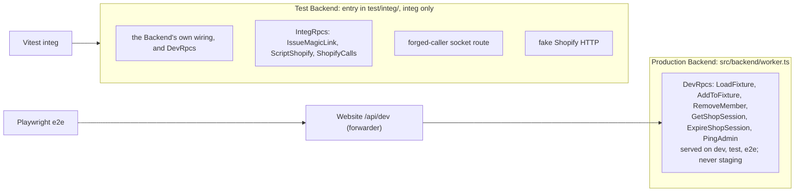
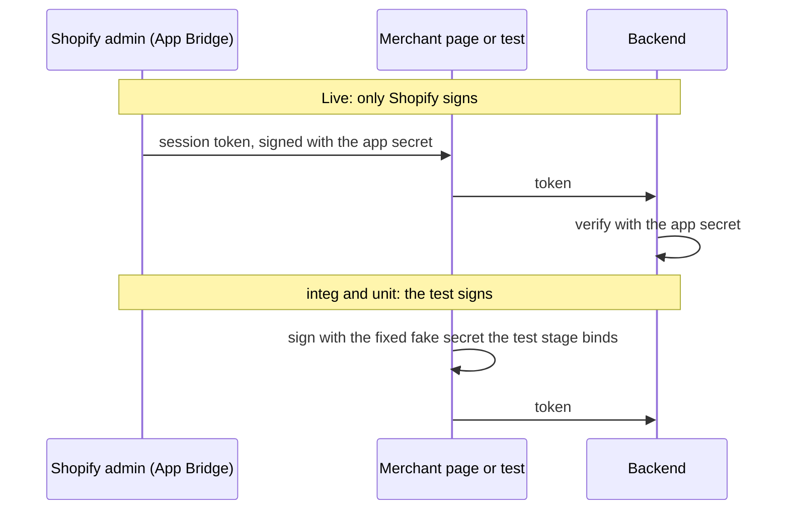
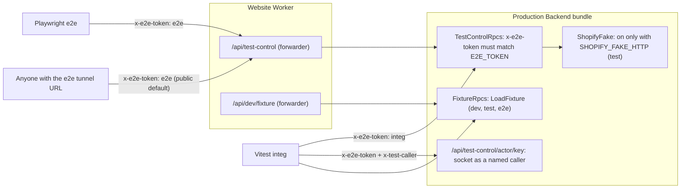

# Testing: what each layer is for, and getting e2e onto the live system

Status: research, 2026-10-16. **Settled**: every question is decided (§1). Not implemented; spikes S1–S5 come before the plan (§5).

**The question.** e2e ran most of its specs on fake shops, with a forged merchant token, through a test back door opened by a token anyone can read. That goes against what an e2e test is for: as much of the live system as possible. This doc settles what each test layer is for, where fakes belong, what e2e runs on, where test-only code lives, and how e2e stays parallel.

**How to read it.** §1 lists every decision in one line. §2 is the resulting design, with diagrams. §3 states each decision in full. §4 is background and evidence. §5 and §6 are the spikes and what changes.

---

## 1. Decisions

All agreed in review, 2026-10-16.

| Q   | Decision                                                                                                                                    |
| --- | ------------------------------------------------------------------------------------------------------------------------------------------- |
| Q1  | e2e runs the real system; fakes live in integ.                                                                                              |
| Q2  | e2e setup opens the app in the e2e store once, then loads a small e2e fixture once, before any spec.                                        |
| Q3  | e2e runs in parallel: no spec replaces the fixture; each spec adds its own uniquely named data (`AddToFixture`) and asserts only on it.     |
| Q4  | `E2E_TOKEN` goes. What e2e still needs is served by environment, never on a deployed stage.                                                 |
| Q5  | The merchant in e2e only through the real embedded admin; `/merchant/$key` and the token signer leave production code.                      |
| Q6  | Fake shops only in integ; e2e's seed is the admin alone (`seed/e2e.sql`).                                                                   |
| Q7  | The refresh spec stays on real Shopify, through three dev procedures; `PingAdmin` retires with order sync.                                  |
| Q8  | integ stays Backend only; the Website's own checks get unit tests.                                                                          |
| Q9  | integ and unit tests sign their own merchant tokens with a fixed fake secret; no endpoint signs tokens.                                     |
| Q10 | e2e signs in through the real sign-in form and the link it shows.                                                                           |
| Q11 | No Shopify products or orders in the e2e store until the order-sync e2e needs them.                                                         |
| Q12 | `PLAYWRIGHT_TEST_BASE_URL`, the unused deployed-target path, is removed.                                                                    |
| Q13 | Every e2e run needs the Shopify admin login; accepted.                                                                                      |
| Q14 | This doc supersedes `docs/e2e-token-research.md` in `wt-01`; delete it there.                                                               |
| Q15 | Test control leaves the production Backend: e2e's needs become `DevRpcs`; integ's move to a test Backend, Alchemy's fixture-Worker pattern. |
| Q16 | No second e2e store: e2e checks the member's one real shop; integ and a browser test check several shops.                                   |
| Q17 | The fake Shopify HTTP layer moves into the test Backend; production carries no fake.                                                        |
| Q18 | Naming marks the door: `DevRpcs` on `/api/dev` in `src/{contract,backend}/dev.ts`; `IntegRpcs` only under `test/integ/`.                    |
| Q19 | integ files get a stage each, so they run in parallel, if spike S5 holds.                                                                   |

---

## 2. The design

### 2.1 Where test machinery lives

There are two doors, one per layer, and they never mix.



- **`DevRpcs`** is the one dev door in production code. It grows out of today's `FixtureRpcs`: one path, `/api/dev`; one binding, set by the stack on `dev`, `test` and `e2e` only, the rule already chosen for the fixture. Its tunnel exposure is the one already accepted for the fixture and for dev's inline sign-in.
- **The test Backend** is Alchemy's documented way to test a Worker's runtime from outside: a fixture Worker in the test tree, built from the same wiring, exposing one RPC per behaviour, deployed by the test stack and driven with `Test.rpcClientLayer`. Alchemy tests its own Durable Objects this way. It holds everything only integ may do: sign a user in without a page, script Shopify, forge a socket caller.

Production code then has no token, no forged identity, no token signer and no fake Shopify.

### 2.2 The procedures

| Procedure                       | Group        | Does                                                                                          | Used by                                        |
| ------------------------------- | ------------ | --------------------------------------------------------------------------------------------- | ---------------------------------------------- |
| `LoadFixture`                   | `DevRpcs`    | Replaces one installed shop's members, teams, workflows and orders. Setup only. Exists today. | `vp run fixture`, `db:reset`, e2e setup, integ |
| `AddToFixture`                  | `DevRpcs`    | Takes the same `ShopFixtureData` shape and only adds. How a spec arranges its own data.       | e2e, integ                                     |
| `RemoveMember`                  | `DevRpcs`    | Removes a member and revokes their sockets; revocation is the behaviour under test.           | e2e, integ                                     |
| `GetShopSession`                | `DevRpcs`    | Reads a stored Shopify session, never its tokens.                                             | e2e refresh, integ                             |
| `ExpireShopSession`             | `DevRpcs`    | Ages the stored access token; `invalidate` also kills the refresh token.                      | e2e refresh, integ                             |
| `PingAdmin`                     | `DevRpcs`    | The Backend's own Admin call with no merchant present. Until order sync makes one.            | e2e refresh, integ                             |
| `IssueMagicLink`                | `IntegRpcs`  | Hands back a sign-in link; integ has no page to read it from.                                 | integ                                          |
| `ScriptShopify`, `ShopifyCalls` | `IntegRpcs`  | Script the fake Shopify HTTP layer and read back its calls.                                   | integ                                          |
| forged-caller route             | test Backend | Opens a socket as any caller the test names.                                                  | integ                                          |

**Where the endpoint stops growing.** One procedure per job, each plain, no modes. No generic "run this SQL" or "call this actor method": that would cut the count by hiding what the tests depend on. `AddToFixture` grows with the slices (workflows, orders) by reusing the fixture's schema, rather than adding a procedure per kind of row.

### 2.3 Parallel e2e

Legacy ran `workers: 1` because every spec reseeded the one dev store, and its seed replaced the shop wholesale: two specs at once clobbered each other. With one real e2e store per checkout, the same shared shop is the constraint here. The rule that makes it safe to run in parallel, stated once on `AddToFixture`:

- the fixture loads once, in setup; no spec calls `LoadFixture`;
- each spec adds its own data under names derived from its test id (`<testId>@e2e.test`, a workflow named for its test, an order with its own tag) and asserts only on that data; no spec counts or lists every row;
- specs that share one piece of state serialize within their file (`shop.spec`'s counter does today), and the embedded project keeps `workers: 1` because the refresh spec owns the one session row.

The member and admin specs then run in parallel; only the embedded ones are serial.

**2026-10-19:** the embedded project now runs 4 workers (each file still serial in itself), and `refresh.spec` is its own `refresh` project, alone after every other project. It is the only spec that ages the session row.

### 2.4 Environments

| Environment    | Shopify                              | Shops                                        | Sign-in                            | Arrange through                                                                                  |
| -------------- | ------------------------------------ | -------------------------------------------- | ---------------------------------- | ------------------------------------------------------------------------------------------------ |
| `test` (integ) | fake HTTP, fixed fake key and secret | `test.sql`'s fake shops, and inline fixtures | `IssueMagicLink` (test Backend)    | `DevRpcs` and `IntegRpcs`, on the test Backend                                                   |
| `e2e`          | real CLI app, real e2e store         | **the real e2e store only**                  | **the sign-in form's inline link** | **one embedded load, then `LoadFixture` once**; then `DevRpcs`; the product's UI where it exists |
| `dev`          | real CLI app, real dev store         | the real dev store                           | the sign-in form                   | `vp run fixture`, `db:reset`                                                                     |
| `staging`      | real                                 | real                                         | mailed                             | nothing                                                                                          |

e2e setup is one chain:

```
shopify-admin (login export) → install (embedded load on the e2e store: writes its ShopSession)
  → fixture (LoadFixture: the e2e fixture into the e2e store) → sign-in (one storage state per role)
  → chromium specs (parallel) and embedded specs (serial)
```

---

## 3. Decisions in full

**Q1. e2e runs the real system; fakes live in integ.** e2e: a real Shopify store, the real app through Shopify CLI, the real tunnel, the real embedded admin, the real sign-in form, the real Website in front of the real Backend. integ: the Backend in workerd, with whatever fakes make a hard case reproducible on demand (Shopify answering 401 or 429, fake shops, forged socket callers, expired sessions). A case that cannot be produced against real Shopify on demand belongs in integ, not in e2e with a fake. It is how legacy ran: one real store, a seed endpoint that refused an uninstalled shop (409), the merchant only through the embedded admin, sign-in through the link the page shows.

**Q2. One embedded load, then `LoadFixture`, once, in setup.** A Playwright setup project, after `shopify-admin`, opens the app in the e2e store (the token exchange writes its `ShopSession`), then calls `LoadFixture` on the e2e server's localhost port with an **e2e fixture**, retrying while it answers `ShopNotInstalled`, as `db:reset` does. The fixture is a small `ShopFixtureData` in `test/e2e/`, not the dev fixture: specs assert on its names, and the dev fixture stays free to change for screenshots. It holds members and teams only until a spec reads more. With `E2E_REUSE_SERVER=1` it runs again on the reused server, which also clears the last run's additions.

**Q3. Parallel e2e: add your own, assert on your own.** No spec replaces the fixture. A spec arranges its own data with `AddToFixture`, under names derived from its test id, and asserts only on that data (§2.3). Legacy's per-spec reseed, which forced one worker, is not adopted. `AddToFixture` replaces today's `AddMember`; the arrangement moves to the admin's own UI where it exists.

**Q4. `E2E_TOKEN` goes.** What e2e still needs is `DevRpcs`, bound by the stage's environment, never on a deployed stage. The tunnel exposure is the one already accepted for dev, once the signing oracle is gone (Q5).

**Q5. The merchant in e2e only through the embedded admin.** `IssueMerchantSessionToken`, `/merchant/$key` and `Shopify.signSessionToken` leave production code. The merchant specs move to the embedded project once the App Home renders the shop page (today it shows "We got here"); until then integ covers the merchant role. "A merchant whose Shopify session expired" moves to integ for good: a real App Bridge token cannot be made to arrive expired.

**Q6. Fake shops only in integ.** `seedFileFor` maps `e2e` to a new `seed/e2e.sql` holding only the admin (`a@a.com`). `test.sql` keeps `seed-shop` and `other-shop` for integ. The member-area specs move to the e2e store. `actor-upgrade.spec`'s not-a-member case uses a shop key with no rows: the gate answers 404 for a missing shop and a non-member alike.

**Q7. The refresh spec stays on real Shopify.** It is the only test of Shopify's real refresh grant and its real 401. It ages the stored token (`ExpireShopSession`), makes the Backend's own Admin call (`PingAdmin`) and reads the session back (`GetShopSession`), all in `DevRpcs`. `PingAdmin` retires when order sync gives the Backend a real no-merchant Admin call.

**Q8. integ stays Backend only.** Adding the Website would start a Vite dev server per integ file, on one more port per checkout. The gaps are closed where the code lives: a unit test for `rejectRequest`; the actor route's `Origin` check moved into a function with a unit test; the auth proxy's allow-list stays covered by `http.spec`. `baton-test` stays beside `baton`, sharing `wireBackend`.

**Q9. Tests sign their own merchant tokens.** A merchant is identified by a Shopify **session token**: a short JWT that Shopify signs with the app's API secret and the Backend verifies with the same secret. Whoever holds the secret can make one.



`test` gets a fixed fake API secret, a constant beside the fixed fake key, instead of `Alchemy.makeRandom`. A test helper signs with it. `shop-actor.test.ts`, the one integ caller of `IssueMerchantSessionToken`, and the unit tests that call `signSessionToken` switch to the helper. The fake secret protects nothing: no real app uses it. Dev and e2e without the CLI (a bare `alchemy destroy`) share the constant.

**Q10. e2e signs in through the real form.** `auth.setup` fills `/sign-in`, follows the inline link the page shows, once per role, and saves storage state; `ownMember` does the same for its own address. The limiter is open under `alchemy dev`, so parallel sign-ins are not throttled.

**Q11. No Shopify products or orders in the e2e store yet.** That needs a one-time `shopify store auth` on each e2e store with write scopes, and `requireFixtureStore` to accept e2e stores. It comes with the order-sync e2e, which `docs/orders-slice-research.md` (its Q12) places on the e2e store.

**Q12. The deployed-target path goes.** `PLAYWRIGHT_TEST_BASE_URL` points the chromium specs at a deployed URL; nothing uses it, and it would need test control on a deployed stage. It goes with `sign-in.spec`'s `@dev-only` tag, which nothing filters on. Smoke tests against staging, if wanted later, are their own design with a real inbox.

**Q13. Every e2e run needs the Shopify admin login.** Every spec depends on the install step, which depends on the exported login (and, when stale, a Keychain prompt). The export is cached (`adminSessionFresh`); there is no CI to break. Chromium specs may run beside the refresh spec because none of them reads the offline token: `PingAdmin` is the only caller of `ShopifyAdmin`, and the member gate reads the sign-in session and `Member` rows.

**Q14. This doc supersedes `docs/e2e-token-research.md`** (uncommitted, in `wt-01`). Its inventory and several answers are carried here (§4.6). Delete it from `wt-01`, from that worktree's own thread.

**Q15. Test control leaves the production Backend** (§2.1). e2e's procedures join `LoadFixture` in `DevRpcs`. integ deploys a test Backend: a Worker whose entry file is in `test/integ/`, built from the Backend's wiring, plus `IntegRpcs`, the forged-caller route and the fake Shopify HTTP. The Backend's `Effect.gen` body becomes a function both entries call; the production entry never imports the test one. It depends on spike S4; if S4 fails, the fallback is one test-control group in the production Backend, gated by environment (`test` only for the integ procedures). e2e never imports the integ client.

**Q16. No second e2e store.** A member may belong to several shops and the product keeps supporting it, but that is a fact about `Members.listShopsOf` and the list page, not about Shopify. e2e checks the one real shop and opens it; integ proves several on `test.sql`'s two fake shops, through `BackendApi`, and a browser test covers the list.

**Q17. No fake Shopify in production.** `@shopify/shopify-api` sends every HTTP call through one replaceable function (`setAbstractFetchFunc`). `ShopifyFake` replaces it with a scripted answerer, so integ can make Shopify answer 401, 429 or any body and read back the calls. It moves into the test Backend, which replaces the function in its own entry. If S4 fails, it stays in `src/`, inert without `SHOPIFY_FAKE_HTTP`, until another seam is found.

**Q18. Naming marks the door, at the group level.** Production: one group, `DevRpcs`, in `src/contract/dev.ts` and `src/backend/dev.ts`, on `/api/dev`, behind one binding. Anything named `Dev*` or under `/api/dev` is dev and test machinery, and nothing else is. integ: `IntegRpcs` and the test Backend, only under `test/integ/`, never in `src/`. Procedures carry no prefix of their own; the group and the path already say it.

**Q19. integ files run in parallel, each on its own stage.** Today every integ file deploys and destroys the checkout's one `test` stage in turn (`fileParallelism: false`). Alchemy isolates parallel suites by stage. Give each file its own stage (`test-<user>[-wt-NN]-<file>`, which `PerDeveloperStage` must then accept) and let files run in parallel, one workerd each. If spike S5 shows the memory or port cost is too high, keep the one stage and run files serially.

---

## 4. Background

Legacy paths are relative to `refs/baton-legacy/`; Alchemy paths to `refs/alchemy/`.

### 4.1 The four layers today

| Layer   | Runner                         | Runtime                                                                                                       | Shopify                                                                                | Shops                                                   | Website                                   | What it proves                                                                            |
| ------- | ------------------------------ | ------------------------------------------------------------------------------------------------------------- | -------------------------------------------------------------------------------------- | ------------------------------------------------------- | ----------------------------------------- | ----------------------------------------------------------------------------------------- |
| unit    | Vitest `unit`                  | Node                                                                                                          | `Shopify.layerWith` over a test app; `ShopSessions.layerTest`                          | in-memory rows                                          | no                                        | Services, schemas, row builders, scripts' pure logic                                      |
| browser | Vitest `browser`               | Chromium (Vitest browser mode)                                                                                | none                                                                                   | none                                                    | components only, server functions stubbed | Components render and behave                                                              |
| integ   | Vitest `integ`, `alchemy/Test` | workerd under `alchemy dev`, the checkout's `test` stage, deployed and destroyed per file, one file at a time | fake HTTP layer (`ShopifyFake`, `SHOPIFY_FAKE_HTTP`), fake app key and a random secret | `seed/test.sql`: `seed-shop`, `other-shop`, fake tokens | **no** (`test/integ/stack.ts`)            | The Backend against real D1, real actors, real Better Auth; Shopify's protocol edge cases |
| e2e     | Playwright                     | `shopify app dev` on the e2e store, `e2e` stage, destroyed at each server start                               | the real CLI app                                                                       | `seed/test.sql`'s fake shops **and** the real e2e store | yes                                       | Sign-in, the member area, the admin area, the embedded admin                              |

### 4.2 e2e today, spec by spec

| Spec                    | Runs on                             | Arranged through                                                                                                                                      |
| ----------------------- | ----------------------------------- | ----------------------------------------------------------------------------------------------------------------------------------------------------- |
| `auth.setup.ts`         | —                                   | `IssueMagicLink` (test control) for `a@a.com` and `m1@m.com`, storage state saved                                                                     |
| `sign-in.spec`          | the real form                       | the inline link the page shows; tagged `@dev-only`, which nothing filters on                                                                          |
| `http.spec`             | no shop                             | `signIn` fixture (`IssueMagicLink`), then plain requests: guards' redirects, the auth proxy's allow-list                                              |
| `shell.spec`            | `seed-shop`, `other-shop` (fake)    | `m1@m.com`'s storage state; asserts **two** shops listed; the admin's sign-out signs in through `IssueMagicLink`                                      |
| `members.spec`          | `seed-shop`, `other-shop` (fake)    | asserts `test.sql`'s three member rows; `AddMember`                                                                                                   |
| `shop.spec`             | `seed-shop` (fake)                  | serial file; `ownMember` (`AddMember` + `IssueMagicLink`), `RemoveMember`, and a merchant window from `IssueMerchantSessionToken` on `/merchant/$key` |
| `actor-upgrade.spec`    | `seed-shop`, `other-shop` (fake)    | the `Origin` check over `node:http`; `ownMember` on `seed-shop` visiting `other-shop`                                                                 |
| `embedded/app.spec`     | the real e2e store                  | the Shopify admin login (`shopify-admin.setup.ts`, exported from Chrome); `GetShopSession` to inspect the exchange                                    |
| `embedded/refresh.spec` | the real e2e store and real Shopify | `ExpireAccessToken`, `PingAdmin`, `GetShopSession`                                                                                                    |

Only the two embedded specs touch the real store. What was wrong with that:

1. **Fake shops.** The member area was tested on a shop never installed, with tokens Shopify never issued.
2. **A forged identity.** The merchant specs used a token signed by test control, on a production route that existed only for them (§4.3).
3. **A test door through the tunnel.** Test control on the e2e stage sat behind a token anyone can read. With the real app's secret behind it, that was a signing oracle for the real app while the e2e server ran.
4. **Two kinds of e2e.** Member specs needed no Shopify login; embedded specs did.

### 4.3 The forged merchant

On the e2e stage the Backend holds **the real CLI app's secret**, so `IssueMerchantSessionToken` signs a Shopify session token the Backend cannot tell from a real one, for any shop name. `/merchant/$key` is a production route that exists only so e2e can open a merchant page without App Bridge. Both are reachable through the e2e server's tunnel, guarded only by `x-e2e-token`, whose default value, `"e2e"`, is in `playwright.config.ts`.

The dev server and the e2e server run the same CLI app (`shopify app dev --config shopify.app.toml` in both), so they share its secret: a token forged through the e2e tunnel is also a valid merchant for the dev stage's installed shop, while both run.

The JSDoc on `Shopify` and on `TestControlRpcs` says the merchant window "exists in dev and e2e". It does not exist in dev: nothing binds `E2E_TOKEN` there.

### 4.4 Test control today

`TestControlRpcs` (`src/contract/test-control.ts`), implemented by `TestControlHandlers` (`src/backend/test-control.ts`), is mounted by the production Backend on `/api/test-control` when the stage binds `E2E_TOKEN`; the Website forwards the path. It ships in every Backend bundle, staging's included, and answers 404 there. Beside it: the forged-caller route `/api/test-control/actor/<key>`, and `ShopifyFake`.



It does five jobs: signing a user in without mail (`IssueMagicLink`), arranging data (`AddMember`, `RemoveMember`), forging an identity (`IssueMerchantSessionToken`, the forged-caller route), inspecting or aging stored Shopify state (`GetShopSession`, `ExpireAccessToken`, `PingAdmin`), and scripting the fake Shopify (`ScriptShopify`, `ShopifyCalls`).

**Why integ needs a door at all.** An integ test talks to a real Backend in workerd over HTTP, from outside; it cannot reach into the Worker's memory, D1 or a Durable Object the way a unit test reaches a layer. Legacy could: its integ ran inside workerd through `@cloudflare/vitest-plugin` (`test/integration/vitest.config.ts`), with `env` bindings and `runInDurableObject`. That plugin is ruled out here. Alchemy's own answer is the fixture Worker (§4.5).

### 4.5 What Alchemy offers for testing

From `website/src/content/docs/testing/` and `AGENTS.md` ("Test Fixtures for Effect-Native Workers"):

- **Fixture Workers.** A test-only Worker in the test tree binds what is under test and exposes one HTTP or RPC route per behaviour; the test stack deploys it and `Test.rpcClientLayer` drives it. Alchemy tests its own Durable Objects this way (`packages/alchemy/test/Cloudflare/Workers/fixtures/rpc-do-namespace-do-rpc/`). The docs say a separate workerd-plus-Vitest-plugin setup is unnecessary. This is Q15's test Backend.
- **Stage per run.** Alchemy isolates parallel suites by giving each its own stage. This is Q19.
- **Shared deploys.** Same state and stage make a second file's `deploy(Stack)` a no-op diff. Not adopted: Q19 isolates by stage instead.
- **`QueryDatabaseLocal`.** Reads and writes local D1 from Node, as `Seed` already does, but boots a fresh workerd per query, runs only during stack evaluation, and cannot reach Durable Object storage. Not a basis for test arrangement.
- **e2e.** Alchemy has no shortcut for it: e2e runs the production stack, so its door has to be production code (`DevRpcs`), behind the environment gate.

### 4.6 Test machinery in production code

From `docs/e2e-token-research.md` §4.1, updated for `main`:

| #   | Piece                                                      | Gate                               | Used by                             | Fate                                                |
| --- | ---------------------------------------------------------- | ---------------------------------- | ----------------------------------- | --------------------------------------------------- |
| P1  | `E2E_TOKEN`, `TestControlRpcs`, `TestControlAuth`          | token present                      | e2e, integ                          | Deleted; split into `DevRpcs` and `IntegRpcs` (Q15) |
| P2  | `/api/test-control` Website forwarder                      | Backend 404s without token         | e2e                                 | Replaced by `/api/dev` (Q18)                        |
| P3  | `/api/test-control/actor/<key>`, forged `ConnectionCaller` | token                              | integ                               | Test Backend only (Q15)                             |
| P4  | `Shopify.signSessionToken`                                 | none                               | e2e merchant window, unit, integ    | A test helper (Q5, Q9)                              |
| P5  | `/merchant/$key`                                           | none                               | e2e only                            | Deleted (Q5)                                        |
| P6  | Fake Shopify HTTP                                          | binding on `test` only             | integ                               | Test Backend only (Q17)                             |
| P7  | Fake app key and random secret                             | no real app                        | integ; dev and e2e without the CLI  | Fixed fake secret (Q9)                              |
| P8  | Inline magic links                                         | `alchemy dev` or token             | dev sign-in page, e2e, integ        | Kept, under `alchemy dev` only                      |
| P9  | Fake shops                                                 | `seed/test.sql` (`test` and `e2e`) | integ, e2e member area              | integ only (Q6)                                     |
| P10 | `SEED_SHOP` in web code                                    | —                                  | —                                   | Gone in 38fb039                                     |
| P11 | `/api/dev/fixture`, `LoadFixture`                          | environment: `dev`, `test`, `e2e`  | `vp run fixture`, `db:reset`, integ | Grows into `DevRpcs` (Q15, Q18)                     |

### 4.7 integ without the Website

`test/integ/stack.ts` deploys the Backend alone: under `alchemy dev` the Website would start the TanStack Start dev server and want a port. `baton-test` binds `AUTH_ORIGIN` and `appUrl` to the Backend's own URL. integ cannot reach the Website's forwarders, `rejectRequest`'s body checks, the actor route's `Origin` check, the auth proxy's allow-list, server functions or SSR; e2e reaches those on the paths its specs take. `rejectRequest` has no unit test today, and the `Origin` check is inline in the `/api/actor/$key` handler (Q8).

### 4.8 What changed since `e2e-token-research.md`

- **Gating by environment is decided.** For the fixture the user chose environment only, over a localhost guard: a hostname check is forgeable through Alchemy's dev proxy (`X-Forwarded-Host`), and dev already hands the admin's magic link to anyone on the tunnel.
- **The seed endpoint exists, as the fixture.** What landed is `/api/dev/fixture`, `LoadFixture`, which replaces one installed shop's members, teams, workflows and orders.
- **`SEED_SHOP` left web code.** `/shop` lists `Members.listShopsOf`.
- **`dev.sql` has no fake shops.** Dev's shop data comes from the fixture, which `db:reset` applies after opening the app, retrying `LoadFixture` while it answers `ShopNotInstalled`.
- **Legacy's serial e2e.** Its specs each reseeded the one dev store wholesale, so it ran `workers: 1` with a preflight that refused a run without a `ShopSession`. Q3 chose differently.

---

## 5. Spikes before planning

- **S1. Install from Playwright.** A setup project with the embedded project's browser settings (`channel: "chrome"`, the exported login) opens the app in the e2e store with `gotoApp`, and the token exchange lands within its timeouts. The wait is S2's retry on `ShopNotInstalled`.
- **S2. `LoadFixture` against the e2e server.** A Node `RpcClient` in Playwright setup calls the fixture on the e2e port. `scripts/lib/fixture.ts` holds the call, but `applyFixture` is bound to `SHOPIFY_DEV_STORE`, `WEBSITE_PORT` and the store half; the D1 half needs to be callable with a URL, a shop and a fixture.
- **S3. The member area on a real installed shop.** One existing `shop.spec` case, run against the e2e store after S1 and S2, passes unchanged apart from the shop key.
- **S4. A test Backend (Q15).** `test/integ/stack.ts` deploys a Worker whose entry is a file in `test/integ/`, built from the Backend's wiring plus one integ-only procedure and the fake Shopify fetch. `ShopActor` is bound and reachable, `auth.test.ts` passes against it, and the Backend bundle `vp build` makes has no trace of the integ additions.
- **S5. A stage per integ file (Q19).** Two integ files run at once, each on its own `test-…-<file>` stage, both pass, and both destroy cleanly; measure memory and wall-clock against today's serial run.

## 6. What changes

| Piece                                                                  | Fate                                                                                     |
| ---------------------------------------------------------------------- | ---------------------------------------------------------------------------------------- |
| `E2E_TOKEN`, `TestControlAuth`, `TestControlRpcs`, `/api/test-control` | Deleted (Q4, Q15)                                                                        |
| `FixtureRpcs`, `/api/dev/fixture`, `FIXTURE_ENDPOINT`                  | Grow into `DevRpcs` on `/api/dev`, one binding, in `src/{contract,backend}/dev.ts` (Q18) |
| `AddMember`                                                            | Replaced by `AddToFixture` (Q3)                                                          |
| `RemoveMember`, `GetShopSession`, `PingAdmin`                          | `DevRpcs`; `PingAdmin` until order sync (Q7)                                             |
| `ExpireAccessToken`                                                    | `DevRpcs`, as `ExpireShopSession` (Q7)                                                   |
| `IssueMagicLink`, `ScriptShopify`, `ShopifyCalls`                      | `IntegRpcs`, test Backend only (Q15)                                                     |
| the forged-caller route, `ShopifyFake`                                 | Test Backend only (Q15, Q17)                                                             |
| `IssueMerchantSessionToken`, `/merchant/$key`, `signSessionToken`      | Deleted from production code; the signer becomes a test helper (Q5, Q9)                  |
| `Alchemy.makeRandom("ShopifyApiSecret")`                               | A fixed fake secret constant (Q9)                                                        |
| the Backend's `Effect.gen` body                                        | A function both the production and the test entry call (Q15)                             |
| `seed/test.sql`                                                        | integ only; `seed/e2e.sql` is the admin alone (Q6)                                       |
| e2e setup                                                              | login export → install → fixture → sign-in (Q2)                                          |
| member-area specs                                                      | On the real e2e store, in parallel, each on its own data (Q3, Q6)                        |
| merchant specs                                                         | Embedded, once the App Home renders the shop page; until then integ (Q5)                 |
| `shell.spec`'s two-shop case                                           | integ and a browser test (Q16)                                                           |
| `rejectRequest`, the `Origin` check in `/api/actor/$key`               | Unit tests; the `Origin` check becomes a function (Q8)                                   |
| integ stages                                                           | One per file, files in parallel, if S5 holds (Q19)                                       |
| `PLAYWRIGHT_TEST_BASE_URL`, `sign-in.spec`'s `@dev-only` tag           | Removed (Q12)                                                                            |
| "in dev and e2e" in the `Shopify` and `TestControlRpcs` JSDoc          | Gone with `signSessionToken` (Q5)                                                        |
| `docs/e2e-token-research.md` in `wt-01`                                | Deleted from that worktree's thread (Q14)                                                |
